# Como o estúdio lê um repositório

A análise de arquitetura (`src/architecture/`) transforma um repositório num **modelo** (`ArchitectureModel`, em `src/shared/studio.ts`) com as partes do sistema, as conexões, os serviços de fora, as rotas, os agentes de IA e as **cenas** da apresentação. É análise estática e determinística: nenhum código é executado e nenhuma LLM é chamada ([ADR 0003](adr/0003-analise-estatica-sem-llm.md)). Roda no navegador de quem entrou, com o token dessa pessoa ([ADR 0002](adr/0002-token-so-no-navegador.md)).

```mermaid
flowchart LR
  A[select.ts<br/>escolhe arquivos] --> B[fetch.ts<br/>baixa os textos]
  B --> C[imports.ts<br/>acha imports]
  C --> D[resolve.ts<br/>import → arquivo ou pacote]
  D --> E[components.ts<br/>partes e camadas]
  E --> F[endpoints.ts<br/>rotas e chamadas HTTP]
  F --> G[externals.ts<br/>bancos, IA, e-mail…]
  G --> H[agents.ts<br/>agentes de IA]
  H --> I[flows.ts + text.ts<br/>cenas e frases]
  I --> M[(ArchitectureModel)]
```

`analyzeRepository()` (em `index.ts`) faz as leituras no GitHub; `buildModel()` é **puro**: a mesma árvore e os mesmos textos dão sempre o mesmo modelo, e é ele que os testes exercitam com um CRM de exemplo (`fixtures.ts`).

## 1. Escolher e baixar os arquivos (`select.ts`, `fetch.ts`)

1. `GET /repos/{o}/{r}` (branch principal, privado ou não), `GET /repos/{o}/{r}/commits/{branch}` (o commit) e `GET /git/trees/{sha}?recursive=1` (a árvore inteira).
2. Entram: código (`.ts .tsx .js .jsx .mjs .cjs .vue .svelte .py .go .java .kt .rb .php .cs`), manifestos (`package.json`, `requirements*.txt`, `pyproject.toml`, `go.mod`, `composer.json`, `Gemfile`, `pom.xml`, `build.gradle`, compose, `Dockerfile`, `tsconfig.json`, `schema.prisma`…) e arquivos de texto com `prompt` no caminho (`.md .txt .yaml .json .jinja…`).
3. Ficam de fora: `node_modules/`, `dist/`, `build/`, `.next/`, `vendor/`, `coverage/`, ambientes virtuais, arquivos minificados, lockfiles, `*.d.ts`, arquivos acima de 200 KB e, **sempre**, `.env*`, `*.pem`, `*.key` e afins.
4. Orçamento: até **700 arquivos e 7 MB**. Prioridade: manifestos, depois código (das pastas mais rasas para as mais fundas), testes por último. Se algo ficou de fora, `stats.truncated` avisa e o mapa mostra uma nota.
5. Os textos vêm pela API GraphQL, em lotes de 60 arquivos, 4 lotes por vez, com o progresso mostrado na tela.

## 2. Imports e resolução (`imports.ts`, `resolve.ts`)

- **JS/TS/Vue/Svelte:** `import … from`, `import '…'`, `export … from`, `require()`, `import()`.
- **Python:** `import a.b`, `from a.b import c`, relativos (`from .models import X`, `from ..core import y`).
- **Go:** `import "x"` e blocos; **Java/Kotlin:** `import a.b.C`; **Ruby:** `require`, `require_relative`; **PHP:** `use`, `require_once`; **C#:** `using`.

Cada import vira um **arquivo do repositório** ou um **pacote**:

- caminhos relativos com extensões e `index.*`, incluindo `.js` → `.ts` (ESM em TypeScript);
- aliases do `tsconfig.json`/`jsconfig.json` (`"@/*": ["./src/*"]`), lidos mesmo com comentários e vírgulas sobrando;
- Python por sufixo de módulo (`crm.leads.views` acha `backend/crm/leads/views.py`), desempatando pela pasta mais próxima de quem importa;
- Go pelo `module` do `go.mod`; Java/Kotlin pelo caminho do pacote;
- módulos nativos (`fs`, `os`, `json`…) são ignorados.

## 3. Partes e camadas (`components.ts`)

- Começa com uma parte por pasta do topo e vai **dividindo a maior** (mais de 30% dos arquivos, ou mais de 40) nas subpastas, até 16 partes. Pastas "embrulho" (`src`, `app`, `lib`, `packages`, `apps`, `internal`…) são sempre abertas. Arquivos soltos numa pasta dividida formam uma parte "direta" (`id` termina em `#direct`). Qual parte é dona de cada arquivo: `componentOf()` em `src/shared/components.ts`, usado também pelos commits.
- **Camada** de cada arquivo por pontuação de nome de pasta e conteúdo, e a da parte pela maioria: telas (`components`, `pages`, `.tsx`…), API (`routes`, `controllers`, `@app.get(`…), segurança (`auth`, `middleware`, `guards`…), regras (`services`, `domain`…), IA (`agents`, `prompts` + SDK de IA), tarefas (`jobs`, `workers`, `celery`…), dados (`models`, `repositories`, `prisma`, `models.Model`…), compartilhado, infraestrutura e testes.
- **Nome** a partir da pasta ("Frontend Pages", "Backend Routes"), único; **tecnologias** pelos pacotes importados; **ponto de entrada** (`main.*`, `server.*`, `manage.py`, `createRoot(`, `app.listen(`, `main`/`bin` do `package.json`…).
- **Conexões**: quantos imports resolvidos vão de uma parte para outra (testes fora).
- **Resumo** de uma frase por camada, com o que foi encontrado ("Recebe os pedidos do sistema, como POST /leads e GET /leads.").

## 4. Rotas e chamadas (`endpoints.ts`)

- Rotas declaradas em Express, Fastify, Hono, Koa, NestJS, FastAPI, Flask, Django (`urls.py`, routers do DRF), Spring, Laravel, Rails, Next.js (`pages/api`, `app/**/route.ts`) e funções da Vercel (`api/`).
- Chamadas do front (`fetch`, `axios`, `$fetch`, `useFetch`…) são casadas com as rotas, normalizando parâmetros (`:id`, `{id}`, `<int:id>`, `[id]`, `${x}`), origem, query e um `/api` na frente. Uma chamada casada vira conexão **tela → API**, mesmo entre linguagens diferentes.

## 5. Serviços de fora (`externals.ts`)

Pelos pacotes usados e imagens do compose: **bancos** (PostgreSQL, MySQL, MongoDB, Prisma, SQLAlchemy, ORM do Django…), **cache** (Redis), **filas** (Celery, BullMQ, RabbitMQ, Kafka…), **IA** (OpenAI, Anthropic, Google, Cohere, Mistral, Groq, Ollama, LangChain/LangGraph, LlamaIndex, Vercel AI SDK), **e-mail** (Nodemailer, SendGrid, Resend…), **pagamento** (Stripe, Mercado Pago, Pagar.me, Asaas, PayPal), **mensagens** (Twilio, WhatsApp, Telegram, Slack, Discord), **arquivos** (S3, Cloudinary, GCS) e **login** (Auth.js, Clerk, Firebase, Passport, Auth0).

## 6. Agentes de IA (`agents.ts`)

Um arquivo que importa um SDK de IA é código de agente. Para cada um:

| O quê | Como é encontrado |
|---|---|
| Fornecedor e framework | Pelo pacote: OpenAI, Anthropic…; LangGraph, LangChain, OpenAI Agents SDK, CrewAI, Vercel AI SDK, LlamaIndex, AutoGen. |
| Modelo | `model: "gpt-4o"`, `model="claude-…"` no arquivo. |
| Instruções | O prompt de sistema: `role: 'system'`, `system:`, `instructions=`, `SystemMessage(...)`, `("system", …)` ou a primeira variável com `prompt`/`instruction`/`system` no nome, inclusive em arquivos de prompt importados. Até ~400 caracteres. |
| Ferramentas | Ferramentas de função da OpenAI e da Anthropic, `@tool` e `Tool(...)` do LangChain, `tool({ … })` do Vercel AI SDK, `@function_tool` do OpenAI Agents SDK, `server.tool(...)`/`@mcp.tool()` de MCP, e os nomes num despachante (`if name == "x"`). Nome e a primeira frase da descrição. |
| Laço | Um `while`/`for` em volta da chamada ao modelo que olha `tool_calls`, `stop_reason`, `finish_reason`, ou um framework que já funciona em laço. |
| Grafo de decisão | **Explícito** num LangGraph (`add_node`, `add_edge`, `add_conditional_edges` com os rótulos das condições, `START`/`END`). **Inferido** nos demais: mensagem → instruções → modelo → "Precisa de ferramenta?" → cada ferramenta → volta ao modelo → resposta; roteadores simples (`intent == "x"`) viram ramos. |

O mapa desenha esse grafo (`src/studio/map/AgentGraph.tsx`) e a apresentação encena a decisão.

## 7. As cenas (`flows.ts`, `text.ts`)

Até 6 cenas, com no máximo 7 participantes e 14 passos cada, nesta ordem:

1. **Como o agente decide** (até 2 agentes): a mensagem chega, o agente lê as instruções, pergunta ao modelo, escolhe entre as ferramentas, usa até duas, pergunta de novo se houver laço e responde.
2. **Pedidos** (até 3 rotas, as de cadeia mais longa, preferindo criar e listar): a pessoa usa a tela, a tela pede à API, a segurança confere, a API passa às regras, as regras buscam ou guardam no banco, e-mails e tarefas saem, a resposta volta e aparece na tela.
3. **Tarefas em segundo plano**, se houver fila: alguém deixa a tarefa, o trabalhador pega e conclui.
4. **Visão geral**, só se nada acima foi encontrado.

Cada passo tem legenda (uma frase curta em português e inglês), balão (uma a três palavras), ação (pedir, conferir, buscar, guardar, pensar, decidir, usar ferramenta, responder, mostrar, enfileirar, enviar) e, quando dá, o arquivo e a linha de onde veio. Verbos das rotas viram palavras: `GET` lista ou vê, `POST` cria, `PUT/PATCH` atualiza, `DELETE` apaga.

No navegador, a apresentação acrescenta a cena de abertura **"Conheça o sistema"** (`src/studio/present/intro.ts`) e os commits viram cenas próprias (`src/studio/works/scenes.ts`, [ADR 0005](adr/0005-commits-como-cenas.md)).

## Limites conhecidos

- Nomes de partes vêm de pastas; o roteiro editável existe para trocá-los pelas palavras do cliente.
- Até 16 partes: pastas além disso ficam fora do mapa.
- Agentes que montam o prompt em tempo de execução, registram ferramentas por reflexão ou chamam a API do modelo com `fetch` cru podem aparecer incompletos ou não aparecer.
- Resolução de Java, Kotlin, Ruby, PHP e C# é aproximada; Go só pelo `go.mod` da raiz.
- Chamadas HTTP só são lidas em arquivos JS/TS/Vue/Svelte.
