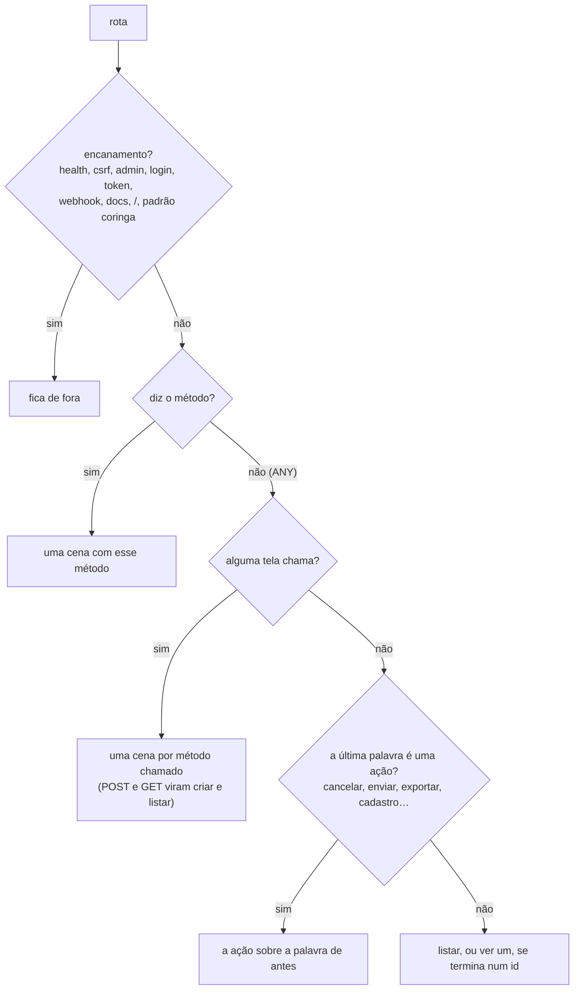

# Como o estúdio lê um repositório

A análise de arquitetura (`src/architecture/`) transforma um repositório num **modelo** (`ArchitectureModel`, em `src/shared/studio.ts`) com as partes do sistema, as conexões, os serviços de fora, as rotas, os agentes de IA e as **cenas** da apresentação. É análise estática e determinística: nenhum código é executado e nenhuma LLM é chamada ([ADR 0003](adr/0003-analise-estatica-sem-llm.md)). Roda no navegador de quem entrou, com o token dessa pessoa ([ADR 0002](adr/0002-token-so-no-navegador.md)).

```mermaid
flowchart LR
  A[select.ts<br/>escolhe arquivos] --> B[fetch.ts<br/>baixa os textos]
  B --> C[imports.ts<br/>acha imports]
  C --> D[resolve.ts<br/>import → arquivo ou pacote]
  D --> E[components.ts<br/>partes e camadas]
  E --> F[endpoints.ts<br/>rotas e chamadas HTTP]
  F --> N[mounts.ts<br/>prefixos montados]
  N --> Q[pages.ts<br/>páginas do site]
  Q --> G[externals.ts<br/>bancos, IA, e-mail…]
  G --> H[agents.ts<br/>agentes de IA]
  H --> P[plain.ts<br/>nomes simples]
  P --> J[features.ts<br/>o que dá para fazer]
  J --> I[flows.ts + text.ts<br/>cenas e frases]
  I --> R[authored.ts<br/>roteiro do autor]
  R --> M[(ArchitectureModel)]
```

`analyzeRepository()` (em `index.ts`) faz as leituras no GitHub; `buildModel()` é **puro**: a mesma árvore e os mesmos textos dão sempre o mesmo modelo, e é ele que os testes exercitam com um CRM de exemplo (`fixtures.ts`).

## 1. Escolher e baixar os arquivos (`select.ts`, `fetch.ts`)

1. `GET /repos/{o}/{r}` (branch principal, privado ou não), `GET /repos/{o}/{r}/commits/{branch}` (o commit) e `GET /git/trees/{sha}?recursive=1` (a árvore inteira).
2. Entram: código (`.ts .tsx .js .jsx .mjs .cjs .vue .svelte .py .go .java .kt .rb .php .cs`), manifestos (`package.json`, `requirements*.txt`, `pyproject.toml`, `go.mod`, `composer.json`, `Gemfile`, `pom.xml`, `build.gradle`, compose, `Dockerfile`, `tsconfig.json`, `schema.prisma`…) e arquivos de texto com `prompt` no caminho (`.md .txt .yaml .json .jinja…`). Também entram o `README` da raiz e o `index.html` (até uma pasta de profundidade) no primeiro nível, e outros `.html` mais ao fundo, depois do código. Esses arquivos servem só à leitura de funcionalidades (seção 10): não entram na análise de código. O mesmo vale para o `repartments.json` da raiz (seção 11).
3. Ficam de fora: `node_modules/`, `dist/`, `build/`, `.next/`, `vendor/`, `coverage/`, ambientes virtuais, arquivos minificados, lockfiles, `*.d.ts`, arquivos acima de 200 KB e, **sempre**, `.env*`, `*.pem`, `*.key` e afins.
4. Orçamento: até **700 arquivos e 7 MB**. Prioridade: manifestos, depois código (das pastas mais rasas para as mais fundas), testes por último. Se algo ficou de fora, `stats.truncated` avisa e o mapa mostra uma nota.
5. Os textos vêm pela API GraphQL, em lotes de 60 arquivos, 4 lotes por vez, com o progresso mostrado na tela.

## 2. Imports e resolução (`imports.ts`, `resolve.ts`)

- **JS/TS/Vue/Svelte:** `import … from`, `import '…'`, `export … from`, `require()`, `import()`.
- **Python:** `import a.b`, `from a.b import c`, relativos (`from .models import X`, `from ..core import y`).
- **Go:** `import "x"` e blocos; **Java/Kotlin:** `import a.b.C`; **Ruby:** `require`, `require_relative`; **PHP:** `use`, `require_once`; **C#:** `using`.

Cada import vira um **arquivo do repositório** ou um **pacote**:

- caminhos relativos com extensões e `index.*`, incluindo `.js` → `.ts` (ESM em TypeScript);
- aliases do `tsconfig.json`/`jsconfig.json` (`"@/*": ["./src/*"]`), lidos mesmo com comentários e vírgulas sobrando;
- Python por sufixo de módulo (`crm.leads.views` acha `backend/crm/leads/views.py`), desempatando pela pasta mais próxima de quem importa;
- Go pelo `module` do `go.mod`; Java/Kotlin pelo caminho do pacote;
- módulos nativos (`fs`, `os`, `json`…) são ignorados.

## 3. Partes e camadas (`components.ts`)

- Começa com uma parte por pasta do topo e vai **dividindo a maior** (mais de 30% dos arquivos, ou mais de 40) nas subpastas, até 16 partes. Pastas "embrulho" (`src`, `app`, `lib`, `packages`, `apps`, `internal`…) são sempre abertas. Arquivos soltos numa pasta dividida formam uma parte "direta" (`id` termina em `#direct`). Qual parte é dona de cada arquivo: `componentOf()` em `src/shared/components.ts`, usado também pelos commits.
- **Camada** de cada arquivo por pontuação de nome de pasta e conteúdo, e a da parte pela maioria: telas (`components`, `pages`, `.tsx`…), API (`routes`, `controllers`, `@app.get(`…), segurança (`auth`, `middleware`, `guards`…), regras (`services`, `domain`…), IA (`agents`, `prompts` + SDK de IA), tarefas (`jobs`, `workers`, `celery`…), dados (`models`, `repositories`, `prisma`, `models.Model`…), compartilhado, infraestrutura e testes.
- **Nome** a partir da pasta ("Frontend Pages", "Backend Routes"), único, usado pelo mapa; e um **nome simples** (`label`, seção 9) para a apresentação; **tecnologias** pelos pacotes importados; **ponto de entrada** (`main.*`, `server.*`, `manage.py`, `createRoot(`, `app.listen(`, `main`/`bin` do `package.json`…).
- **Conexões**: quantos imports resolvidos vão de uma parte para outra (testes fora).
- **Resumo** de uma frase por camada, com o que foi encontrado ("Recebe os pedidos do sistema, como POST /leads e GET /leads.").

## 4. Rotas e chamadas (`endpoints.ts`)

- Rotas declaradas em Express, Fastify, Hono, Koa, NestJS, FastAPI, Flask, Django (`urls.py`, routers do DRF), Spring, Laravel, Rails, Next.js (`pages/api`, `app/**/route.ts`) e funções da Vercel (`api/`). No Django, `path('api/', include(...))` só monta outra lista de rotas e não vira rota; as rotas do Django e do DRF não dizem o método e ficam como `ANY`.
- Chamadas do front (`fetch`, `axios`, `$fetch`, `useFetch`…) são casadas com as rotas, normalizando parâmetros (`:id`, `{id}`, `<int:id>`, `[id]`, `${x}`), origem, query e um `/api` na frente. Uma chamada casada vira conexão **tela → API**, mesmo entre linguagens diferentes. Para uma rota `ANY`, a chamada fica guardada com o método dela (`POST /contracts/`, `GET /contracts/`), e é assim que as cenas sabem se a tela cria ou lista (seção 7).
- Também são lidas como `fetch` as chamadas por wrappers (`api(url, { method })`, também sem a barra inicial) e por objetos de serviço (`ApiService.post('articles/…')`, `requests.get('/articles/' + slug)`, em que a parte somada vira parâmetro).
- Formas de declarar rotas que passaram a ser lidas:
  - **Flask:** `methods=` em tupla. **Spring:** `@RequestMapping(method = POST)`.
  - **Laravel:** `Route::resource` e `apiResource` (com `only`/`except` e aninhados), `Route::match` e o prefixo de `Route::group` e de `Route::prefix()->group()`.
  - **Rails:** `resources` e `resource` com aninhamento (`:article_slug`), `member`/`collection`, `scope` e `namespace`. `devise_for` fica de fora: é login.
  - **Django:** `url()` e `re_path` com regex.
  - **Go:** gin, echo, chi, fiber e gorilla/mux, com grupos.
  - Decoradores Python com argumentos em várias linhas. Rotas de arquivos de teste ficam de fora.

### Prefixos montados em outro arquivo (`mounts.ts`)

Muitas vezes a rota é declarada num arquivo e o prefixo é dado em outro. O estúdio lê onde o prefixo é montado e o junta à rota:

- **FastAPI:** `include_router(x.router, prefix=…)`.
- **Flask:** `register_blueprint(bp, url_prefix=…)`.
- **Express:** `app.use('/api', router)`.
- **Django:** `include()`.
- **Go:** `pkg.Register(v1.Group("/x"))`; valem só as rotas da função que recebe o grupo.

Os prefixos se juntam pela cadeia: um roteador montado dentro de outro leva os dois prefixos.

### Medição com o corpus RealWorld

A mesma API (Conduit, 19 rotas) existe em vários stacks, o que serve de régua. Rotas lidas, antes → depois desta etapa:

| Stack | Antes | Depois |
|---|---|---|
| Express | 19 | 19 |
| NestJS | 19 | 19 |
| Spring | 19 | 19 |
| Flask | 7 | 19 |
| Laravel | 10 | 19 |
| FastAPI | 0 | 19 |
| Rails | 3 | 17 |
| Go | 0 | 17 |
| Django | 2 | 16 |

O que ainda falta: Rails e Go não leem login e cadastro (`devise_for` no Rails; o Go registra essas rotas em outro lugar), e o Django não lê `GET/PUT/DELETE /articles/:slug`, que vêm de um ViewSet.

## 4.1. Páginas (`pages.ts`)

As páginas do site vêm de duas fontes.

**Roteadores no código**, só em arquivos que importam um roteador:

- `<Route path element>` do React Router: pega o componente mais de dentro de um elemento embrulhado (`<Protegida><MinhasReservas/></Protegida>` → `MinhasReservas`) e ignora `*` e `Navigate`.
- Objetos de rota (`createBrowserRouter`, Vue Router), inclusive com import preguiçoso (`() => import('./X.vue')`).

**Arquivos que são páginas pelo lugar onde ficam**, só embaixo da pasta de um `package.json` que usa `next`, `expo-router` ou `nuxt`:

- **Next.js:** `pages/` (sem `pages/api`, `_app`, `_document`, `_error`) e `app/**/page.*`.
- **Expo Router:** `app/` (sem `_layout` e `+not-found`; grupos `(x)` somem do endereço).
- **Nuxt:** `pages/*.vue`.

**Nome** da página, nesta ordem: o título da própria página, se tiver até 4 palavras (sem o emoji do começo); o nome do componente em palavras (`MinhasReservas` → "Minhas reservas"); a última palavra do endereço. A raiz é "Início".

O modelo ganha `pages` (`{ path, name, file, source }`). A página empresta o nome a uma tela sem título, e as peças que ela importa contam como mostradas nela.

## 5. Serviços de fora (`externals.ts`)

Pelos pacotes usados e imagens do compose: **bancos** (PostgreSQL, MySQL, MongoDB, Prisma, SQLAlchemy, ORM do Django…), **cache** (Redis), **filas** (Celery, BullMQ, RabbitMQ, Kafka…), **IA** (OpenAI, Anthropic, Google, Cohere, Mistral, Groq, Ollama, LangChain/LangGraph, LlamaIndex, Vercel AI SDK), **e-mail** (Nodemailer, SendGrid, Resend…), **pagamento** (Stripe, Mercado Pago, Pagar.me, Asaas, PayPal), **mensagens** (Twilio, WhatsApp, Telegram, Slack, Discord), **arquivos** (S3, Cloudinary, GCS) e **login** (Auth.js, Clerk, Firebase, Passport, Auth0).

## 6. Agentes de IA (`agents.ts`)

Um arquivo que importa um SDK de IA é código de agente. Para cada um:

| O quê | Como é encontrado |
|---|---|
| Fornecedor e framework | Pelo pacote: OpenAI, Anthropic…; LangGraph, LangChain, OpenAI Agents SDK, CrewAI, Vercel AI SDK, LlamaIndex, AutoGen. |
| Modelo | `model: "gpt-4o"`, `model="claude-…"` no arquivo. |
| Instruções | O prompt de sistema: `role: 'system'`, `system:`, `instructions=`, `SystemMessage(...)`, `("system", …)` ou a primeira variável com `prompt`/`instruction`/`system` no nome, inclusive em arquivos de prompt importados. Até ~400 caracteres. |
| Ferramentas | Ferramentas de função da OpenAI e da Anthropic, `@tool` e `Tool(...)` do LangChain, `tool({ … })` do Vercel AI SDK, `@function_tool` do OpenAI Agents SDK, `server.tool(...)`/`@mcp.tool()` de MCP, e os nomes num despachante (`if name == "x"`). Nome e a primeira frase da descrição. |
| Laço | Um `while`/`for` em volta da chamada ao modelo que olha `tool_calls`, `stop_reason`, `finish_reason`, ou um framework que já funciona em laço. |
| Grafo de decisão | **Explícito** num LangGraph (`add_node`, `add_edge`, `add_conditional_edges` com os rótulos das condições, `START`/`END`). **Inferido** nos demais: mensagem → instruções → modelo → "Precisa de ferramenta?" → cada ferramenta → volta ao modelo → resposta; roteadores simples (`intent == "x"`) viram ramos. |

O mapa desenha esse grafo (`src/studio/map/AgentGraph.tsx`) e a apresentação encena a decisão.

## 7. As cenas (`flows.ts`, `text.ts`)

Até 6 cenas, com no máximo 7 participantes e 14 passos cada, nesta ordem:

0. **O que dá para fazer**, antes de todas, se a seção 10 achou 2 ou mais funcionalidades: cada funcionalidade com nome vira um pedido da pessoa (“Passo a passo”) e a resposta da parte que a atende; a que só tem uma frase vira um passo de “mostrar”.
1. **Jornadas**, logo depois de "O que dá para fazer" e antes dos pedidos (veja "Jornadas" abaixo).
2. **Como o agente decide** (até 2 agentes): a mensagem chega, o agente lê as instruções, pergunta ao modelo, escolhe entre as ferramentas, usa até duas, pergunta de novo se houver laço e responde.
3. **Pedidos** (até 3 rotas, as de cadeia mais longa, preferindo criar e listar): a pessoa usa a tela, a tela pede à API, a segurança confere, a API passa às regras, as regras buscam ou guardam no banco, e-mails e tarefas saem, a resposta volta e aparece na tela. Quais rotas entram e como cada uma vira cena está logo abaixo, em "Quais rotas viram pedido".
4. **Tarefas em segundo plano**, se houver fila: alguém deixa a tarefa, o trabalhador pega e conclui.
5. **Visão geral**, só se nada acima foi encontrado.

Cada passo tem legenda (uma frase curta em português e inglês), balão (uma a três palavras), ação (pedir, conferir, buscar, guardar, pensar, decidir, usar ferramenta, responder, mostrar, enfileirar, enviar) e, quando dá, o arquivo e a linha de onde veio. Verbos das rotas viram palavras: `GET` lista ou vê, `POST` cria, `PUT/PATCH` atualiza, `DELETE` apaga.

### Jornadas

Uma jornada conta o que a pessoa faz numa página, do botão até o resultado (`flows.ts`, funções `journeyPlans` e `journeyFlow`; os botões vêm de `screenActionsOf`, em `details.ts`).

**Do botão à chamada**, por leitura no mesmo arquivo:

- O handler cita a declaração que faz a chamada (`cancelar.mutate(id)` para `const cancelar = useMutation(... api('/reservas/1/cancelar') ...)`) ou uma função que a cita.
- O botão de submit pega o `onSubmit` do formulário; no Vue, vale o `@click`.
- **Botão** é qualquer elemento com `onClick`, `onPress`, `@click` ou `type=submit`. O texto vem de `title`, `label`, `titulo`, `rotulo`, `texto`, `text`, `aria-label`, `accessibilityLabel` ou do texto de dentro; botão só com símbolo ("×") fica de fora.
- **Confirmação:** `confirm()`, `Alert.alert()`, `confirmar()` e `perguntar()` viram "a tela pergunta se tem certeza" e "o usuário confirma".

**Quais viram jornada:** a rota com palavra de ação (cancelar, pagar, aprovar, seguir, favoritar…) ou o cadastro primeiro, depois apagar, depois criar ou mudar. Ler não é jornada. São no máximo 2, uma por rota e uma por botão, logo depois de "O que dá para fazer", e a rota contada como jornada não volta como pedido.

**Quem faz:** a pessoa ganha o papel que a pasta ou o endereço da página diz (`(cliente)` → Cliente; também aluno, professor, paciente, vendedor, motorista, organizador, admin).

**Título:** botão de várias palavras é o título ("Sair da turma"); botão de uma palavra vira "O usuário cancela uma reserva".

**Passos:** abre a página → clica no botão (numa reserva, quando a rota é de um item) → [a tela pergunta / o usuário confirma] → a tela pede → [o porteiro confere] → [passa às regras] → as regras fazem no banco → o banco confirma → [e-mail] → resposta → a tela mostra que deu certo. Para caber no limite de passos, sai primeiro o porteiro, depois o e-mail.

Exemplo real (repositório Studio, do autor), "O usuário cancela uma reserva": abre “Minhas reservas” nas páginas, clica em “Cancelar” numa reserva, as páginas pedem para as regras do negócio cancelar a reserva, as regras do negócio cancelam a reserva no banco de dados, o banco confirma: a reserva foi cancelada, as páginas mostram que a reserva foi cancelada.

### Quais rotas viram pedido

- **Fica de fora** o que só mantém o site de pé ou só faz entrar: `health`, `ping`, `csrf`, `/admin/`, `/media/`, `/static/`, `login`, `logout`, `me`, `refresh`, `token`, senha, tudo sob `auth` que não seja cadastro, webhooks (quem chama é um serviço de fora, não a pessoa), documentação da API, a raiz `/` e padrões coringa (`(?P<path>.*)`, `*`). Também fica de fora a rota cujas palavras não nomeiam nada (`/f/<token>`).
- **Ações no fim da rota** dizem o que é feito com a palavra de antes: `/reservas/<id>/cancelar` é "Cancelar reservas", `/contracts/<id>/send/` é "Enviar contracts", `/analises/<id>/exportar/` é "Exportar analises". As ações conhecidas: cancelar, confirmar, recusar, aceitar, aprovar, enviar, publicar, assinar, arquivar, concluir, pagar, retirar, sincronizar, conferir, exportar e baixar (`pdf`, `csv`), em português e inglês. Ação sem palavra de antes vira só o verbo ("Assinar"), e a legenda fala em "registro".
- **Seguir, favoritar e curtir** são ações, e o `DELETE` delas desfaz ("Deixar de seguir", "Desfavoritar"). Um `GET` numa palavra no singular é ver um ("Ver perfil").
- **Cadastro:** `/auth/register/` é "Criar conta"; `/auth/aluno/cadastro/` é "Cadastrar aluno". Vem depois das rotas sobre o que o sistema faz.
- **Ordem:** primeiro as rotas que nomeiam a coisa, depois as de só verbo; dentro disso, as de cadeia mais longa e, no empate, criar antes de listar. Uma cena de leitura e uma de escrita por parte da API.
- Palavras com hífen viram palavras soltas ("meus-dados" → "meus dados"), e as terminadas em -ção, -são, -dade, -gem, -ise e -tude concordam no feminino ("a nova analise").

No navegador, a apresentação acrescenta a cena de abertura **"Conheça o sistema"** (`src/studio/present/intro.ts`) e os commits viram cenas próprias (`src/studio/works/scenes.ts`, [ADR 0005](adr/0005-commits-como-cenas.md)).

## 8. Detalhes para quem não é técnico (`details.ts`)

Para as legendas dizerem o que a pessoa vê e faz, e não só "a API chama o serviço", o analisador também lê, do próprio código:

- **Modelos de dados** (Prisma, Django, SQLAlchemy, Mongoose, TypeORM, Sequelize): os campos de cada entidade, sem ids, datas automáticas e nada sensível (senhas, tokens, chaves, CPF, cartão).
- **Telas**: o título, os botões e os rótulos dos campos (`<label>`, `placeholder`, `aria-label`), juntando a tela com os componentes que ela importa. O título é o primeiro `<h1>` ou `<h2>` que nomeia uma tela: até cinco palavras, sem ser frase ou pergunta e sem ser cláusula numerada ("1. DO OBJETO", de um contrato mostrado na tela); sem nenhum assim, vale o `document.title`. Arquivos de teste não contam: eles desenham telas de mentira.
- **O que a tela envia** (`JSON.stringify({ … })`, `axios.post(url, { … })`), o **assunto dos e-mails** e o nome das **filas**.
- Nomes de campos viram palavras ("companyName" → "empresa"), com um dicionário de termos comuns em português.

Com isso, uma cena de pedido vira: "O usuário abre a tela de leads, preenche nome, empresa, e-mail e telefone e clica em “Salvar lead”" → "A tela de leads envia o novo lead (nome, empresa, e-mail e telefone) para a recepção" → "As regras do negócio guardam o novo lead no banco de dados: nome, empresa, e-mail e telefone" → "O banco de dados confirma para as regras do negócio: o lead foi guardado" → "As regras do negócio enviam o e-mail “Olá!” usando o serviço de e-mail" → "A tela de leads mostra que o lead foi salvo". Uma mesma API pode ter uma cena de escrita e outra de leitura (criar e listar); e-mails e tarefas na fila só aparecem nas de escrita, porque ler uma lista não manda e-mail.

## 9. Nomes simples e nomes do código (`plain.ts`)

Quem assiste não programa, então nenhum nome de pasta, de função, de marca ou de modelo aparece nas legendas por padrão. Cada participante de cena tem dois nomes: o **simples** (`name`), que aparece, e o **do código** (`technical`), guardado para quem preferir.

| Participante | Nome simples | Nome do código |
|---|---|---|
| Parte do sistema | O papel dela pela camada ("Telas", "Recepção", "Porteiro", "Regras do negócio", "Bastidores", "Arquivo"), com o assunto da pasta quando há um ("Recepção de pedidos", "Regras de leads"). Pastas genéricas (`routes`, `services`, `pages`…) não dão assunto; um grupo de rotas do Expo Router ou do Next.js dá ("(aluno)" → "Tela de aluno", "(auth)" → "Tela de acesso"). `management/` e `commands/` são "Comandos", `scripts/` é "Rotinas". Uma parte de telas sem assunto que tem uma tela só leva o título dela ("Tela de leads"); uma parte de agente sem assunto que tem um agente só leva o assunto do nome do agente (`support` → "Assistente de atendimento"). Quando partes na raiz de um app dividem o nome dele ("Site", "Aplicativo", "Servidor"), as telas ficam com o nome e as outras ganham o papel nele ("Configuração do site", "Regras do aplicativo"). Os demais nomes repetidos ganham a pasta de cima ou um número; até 28 caracteres. | "Backend Routes" |
| Ferramenta da IA | O verbo e os substantivos traduzidos: `search_leads` → "Buscar leads", `schedule_call` → "Agendar ligação". | `search_leads` |
| Serviço de fora | O tipo de serviço: "Banco de dados", "Fila de tarefas", "Serviço de e-mail", "Modelo de IA". A marca vai para a nota ("PostgreSQL guarda os dados do sistema."). | "PostgreSQL", "gpt-4o-mini" |

As frases usam o nome simples com o artigo e a preposição certos ("a recepção passa o trabalho para as regras do negócio", "no banco de dados"); quando a tela tem título e a parte não foi batizada por ele, a legenda diz qual tela ("O usuário abre “Leads” nas páginas…"). O resumo do sistema também é simples: "O crm tem 12 partes: as telas, a recepção, o porteiro… Usa um banco de dados, uma fila de tarefas, um modelo de IA e um serviço de e-mail."

Como cada legenda nomeia seus participantes pelo nome simples, a apresentação troca um pelo outro palavra a palavra (`applyEdits` em `src/scene/tour.ts`): é assim que as perguntas "Antes de apresentar" mostram os nomes do código e que os nomes escolhidos à mão chegam às legendas ([ADR 0004](adr/0004-apresentacao-no-motor-de-historias.md)).

## 10. Funcionalidades (`features.ts`)

A arquitetura diz como as partes conversam, mas não o que o sistema faz para quem o usa: que uma página desenha uma árvore passo a passo, que um bot responde a `/start`. Isso está nas palavras do próprio autor, então o estúdio lê três lugares, sem inventar nada:

- **O README da raiz.** A frase de abertura (o `about`: a primeira frase depois do título, pulando selos e imagens) e os itens das seções que falam do que o projeto faz (“Funcionalidades”, “Como usar”, “What it does”, “O que o site faz”, “Features”…). Entram bullets com nome em negrito (`- **Passo a passo:** roda mostrando cada linha.`), parágrafos que começam em negrito e linhas de tabela. Seções de instalação, execução, tecnologias, licença e testes ficam de fora, e blocos de código são ignorados. Antes do primeiro `##`, só entram bullets com nome em negrito.
- **Os botões das telas** (`.jsx .tsx .vue .svelte .html`): o texto visível, o `aria-label` ou o `title`. Reconhece `onClick`, `@click`, `(click)` e `<input type="submit">`. Botões de ir e vir (“Fechar”, “Voltar”, “Próximo”, “Sair”…) e textos que são só uma expressão `{x}` ficam de fora.
- **Os comandos**: `/start` de bots (python-telegram-bot e parecidos) e subcomandos de ferramentas de terminal (argparse, commander, typer, click), com a ajuda do comando como detalhe.

Regras:

- O nome fica no idioma do autor, sem emoji, negrito ou pontuação sobrando (“📂 Importar / 💾 Exportar” vira “Importar / Exportar”). Nome com mais de 48 caracteres é frase, não nome; o detalhe tem no máximo 110 caracteres.
- Quando o README e o código dizem a mesma coisa (um botão com o mesmo nome de um item), o item vai primeiro e ganha o arquivo e a linha do botão (`ref`) e o jeito de chegar (`via: 'button'`). O que só o README diz vem em seguida, e depois o que só o código diz.
- No máximo **6** funcionalidades por repositório.

Fallback do `about`, nesta ordem: a frase do README, a descrição do repositório no GitHub (`repo.description`), o `<title>` do `index.html` (sem “Vite + React”, “React App” e títulos de modelo). O `about` abre o resumo do sistema.

Por que README e `.html` ficam fora da análise de código: não têm imports nem rotas e, se entrassem, virariam partes e camadas falsas. Citar “PostgreSQL” num README também não cria um serviço de banco. Por isso `isDocument` os tira antes de partes, rotas e serviços, e a contagem de partes do resumo não inclui os testes.

Limites: um README fraco dá uma cena fraca; o texto vem no idioma do autor, sem tradução; botões montados com texto vindo de variáveis não são lidos; sem README, botão nem comando, a cena não aparece.

## 11. Roteiro do autor (`authored.ts`)

É o último passo: se o repositório tem um `repartments.json` na raiz, ou se a pessoa importou um no estúdio, o que ele diz tem a palavra final. O arquivo é lido como dado (`JSON.parse`, campo a campo, textos cortados, arquivos citados conferidos contra a árvore do repositório), dá o resumo, os nomes das partes, as funcionalidades e as cenas, e **substitui** as cenas lidas do código, que ficam de reserva. Nenhuma LLM é chamada pelo estúdio; quem escreve o arquivo é o autor, ou a IA dele a partir do prompt que o estúdio oferece. O formato, o que é recusado ou vira aviso e o prompt inteiro estão em [roteiro.md](roteiro.md) ([ADR 0010](adr/0010-roteiro-do-autor.md)).

## Limites conhecidos

- Nomes simples vêm do papel da parte e do assunto da pasta; quando a pasta não diz nada do negócio ("Regras do negócio" de `services`), o roteiro editável existe para trocá-los pelas palavras do cliente.
- Até 16 partes: pastas além disso ficam fora do mapa.
- Agentes que montam o prompt em tempo de execução, registram ferramentas por reflexão ou chamam a API do modelo com `fetch` cru podem aparecer incompletos ou não aparecer.
- Resolução de Java, Kotlin, Ruby, PHP e C# é aproximada; Go só pelo `go.mod` da raiz.
- Chamadas HTTP só são lidas em arquivos JS/TS/Vue/Svelte.
- Uma rota `ANY` que nenhuma tela chama e cuja última palavra não é uma ação vira "listar": o estúdio não lê a view do Django para saber se ela também cria.
- As palavras das rotas não ganham acento nem tradução ("analises", "contracts"); o roteiro do autor resolve.
- Rotas declaradas na pasta do projeto Django (a da `settings.py`) aparecem com o nome dela, "Configuração de …".
- A jornada só segue chamadas do próprio arquivo (ou de uma função dele), não um handler importado de outro arquivo.
- Texto de botão vindo de variável não é lido.
- Rotas aninhadas do React Router com caminho relativo ficam sem o pai.
- No Rails, `resources :a, :b do` não aninha os filhos.
