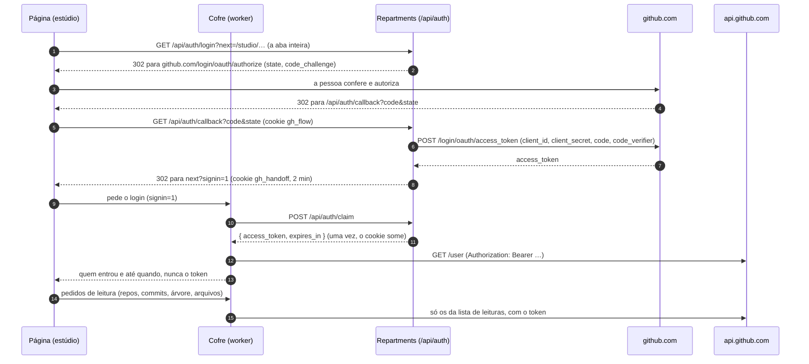
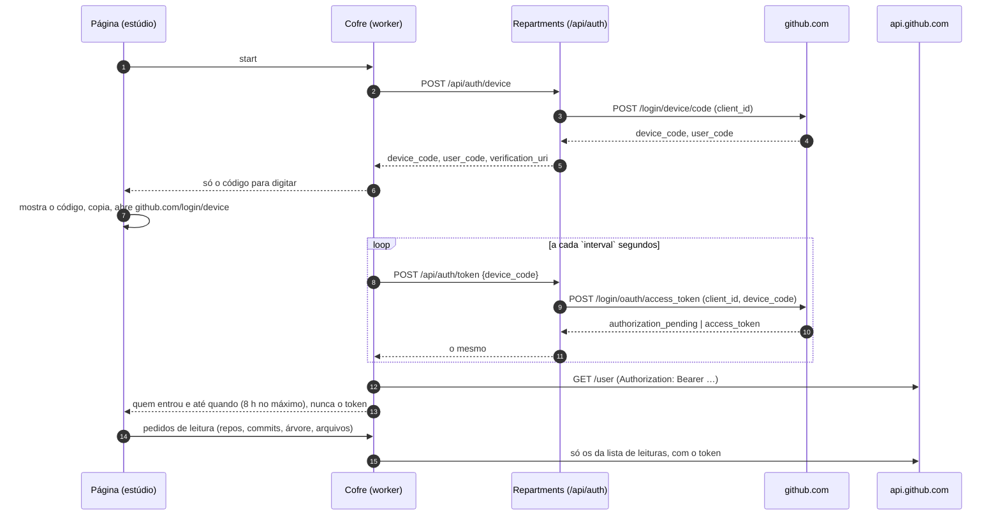

# Referência da API

O Repartments tem poucas rotas próprias: o **prédio público** e o **repasse do login** do estúdio. Todo o resto do estúdio (repositórios, commits, leitura do código) é feito pelo navegador, direto na API do GitHub, com o token da pessoa ([ADR 0002](adr/0002-token-so-no-navegador.md)).

Os tipos de cada resposta estão em [`src/shared/types.ts`](../src/shared/types.ts) (prédio público) e [`src/shared/studio.ts`](../src/shared/studio.ts) (estúdio): eles são o contrato entre as partes.

## Rotas do Repartments

### `GET /api/building?user=<login>[&after=<cursor>]`

O prédio público de um usuário ou organização: até 12 repositórios públicos (6 nos prédios seguintes, a partir de `after`). Resposta `Building`. Erros `BuildingError`: `invalid-user` (400), `not-found` / `no-repos` (404), `rate-limited` (429), `unavailable` (502/503). Cache: 1 h na borda; URLs com outra caixa ou parâmetros extras são redirecionadas (308) para a canônica. Freio: 20 requisições por minuto por visitante. Usa o `GITHUB_TOKEN` do servidor, que só lê dados públicos.

### Login do estúdio (`server/auth.ts`)

Repasse **sem estado** do login do GitHub. Existe porque `github.com/login/...` não aceita pedidos de páginas web. Há dois jeitos: **Continuar com GitHub** (fluxo web, com o segredo do app, [ADR 0008](adr/0008-continuar-com-github.md)) e o *device flow* pelo código ([ADR 0001](adr/0001-login-pelo-device-flow.md)), que fica como alternativa quando não há segredo. Não guarda sessão nem banco; respostas com `Cache-Control: no-store`.

| Rota | Corpo | Resposta |
|---|---|---|
| `GET /api/auth/config` | | `{ enabled, web, devLogin? }`: se o login está configurado (há `GITHUB_CLIENT_ID`); `web` é `true` quando também há `GITHUB_CLIENT_SECRET`, e então o estúdio mostra "Continuar com GitHub". `devLogin` só existe no servidor de desenvolvimento sem app, quando o atalho do GitHub CLI existe. |
| `GET /api/auth/login` | | `?next=/studio/…` (só caminhos `/studio…`). **302** para `github.com/login/oauth/authorize`, com `state` e o desafio PKCE (S256). Guarda `state`, o verificador PKCE e `next` no cookie `gh_flow` (HttpOnly, Secure, SameSite=Lax, 10 min). Sem os dois IDs, volta para `/studio?signin=off`. |
| `GET /api/auth/callback` | | `?code&state`, com o cookie `gh_flow`. Confere o `state` contra o cookie e troca o código por token no GitHub, com o *client secret* e o verificador PKCE. **302** para `next?signin=1`, com o token no cookie `gh_handoff` (HttpOnly, Secure, SameSite=Strict, só para `/api/auth/claim`, **2 min**). Cancelado no GitHub: `?signin=denied`; qualquer outra falha: `?signin=failed`, e o log do servidor diz o que o GitHub respondeu. |
| `POST /api/auth/claim` | | `{ access_token, expires_in? }`, **uma vez**: lê e apaga o cookie `gh_handoff`. Sem nada para entregar, `{ "error": "none" }` (404). Chamada de outro site: 403. Quem chama é o cofre. |
| `POST /api/auth/revoke` | `{ access_token }` | `{ revoked }`. Encerra o token no próprio GitHub (`DELETE /applications/{client_id}/token`, com o *Client ID* e o segredo), para que uma cópia dele, onde quer que esteja, pare de funcionar. O cofre chama ao sair, quando as 8 horas acabam ou quando descarta um token. Sem o segredo (device flow), `{ "revoked": false }`. |
| `POST /api/auth/device` | | `{ device_code, user_code, verification_uri, expires_in, interval }`. Pede um código ao GitHub com o *Client ID* (e o escopo, para OAuth App). |
| `POST /api/auth/token` | `{ device_code }` | `{ access_token, expires_in? }` quando a pessoa autorizou; senão `{ error, interval? }` com `authorization_pending`, `slow_down`, `expired_token`, `access_denied`, `incorrect_device_code` ou `device_flow_disabled`. |
| `GET /api/auth/dev` | | **Só no servidor de desenvolvimento**, sem *Client ID* e a partir da própria máquina: `{ access_token }` com o token do GitHub CLI. |

`POST` exige o cabeçalho `X-Requested-With` e `Origin` do próprio site (403 caso contrário). Freios por visitante: 20 inícios de login (ou códigos, no *device flow*) e 60 consultas por minuto. Erros do repasse: `{ "error": "login-disabled" }` (503, sem *Client ID*), `forbidden` (403), `invalid` (400), `rate-limited` (429), `unavailable` (502), `none` (404, no `claim`).

Quem conversa com o repasse é o **cofre do token** (`src/github/vault-core.ts`), um worker da página, e não a página em si: o token nunca chega ao código da página ([ADR 0002](adr/0002-token-so-no-navegador.md)). No fluxo web, o token passa do cookie do servidor direto para o cofre, pelo `claim`.

### Continuar com GitHub (fluxo web)

### Entrar pelo código (device flow, sem segredo)

## Chamadas ao GitHub feitas pelo navegador

Feitas pelo cofre com o token da pessoa, a pedido de `src/github/*` e `src/architecture/fetch.ts`. O cofre só aceita estas leituras (`src/github/allow.ts`): qualquer outro caminho, método ou uma `mutation` de GraphQL é recusado. A CSP libera só `https://api.github.com` além do próprio site.

| Para quê | Chamada | Onde |
|---|---|---|
| Quem entrou | `GET /user` | `studio/api.ts` |
| Lista de repositórios | `GET /user/repos?per_page=30&page&sort=pushed&affiliation=owner,collaborator,organization_member` (com busca: páginas de 100, filtradas por nome e descrição, até 10 páginas) | `github/repos.ts` |
| Resumo do repositório | `GET /repos/{owner}/{repo}` | `github/repos.ts` |
| Branches | `GET /repos/{owner}/{repo}/branches?per_page=100` | `github/commits.ts` |
| Commits com filtros | `GET /repos/{owner}/{repo}/commits?sha&author&since&until&per_page=40&page` | `github/commits.ts` |
| Arquivos de um commit | `GET /repos/{owner}/{repo}/commits/{sha}` (o diff é cortado em 60 000 caracteres por arquivo e não é mostrado) | `github/commits.ts` |
| Último commit da branch | `GET /repos/{owner}/{repo}/commits/{branch}` | `architecture/fetch.ts` |
| Árvore de arquivos | `GET /repos/{owner}/{repo}/git/trees/{sha}?recursive=1` | `architecture/fetch.ts` |
| Texto dos arquivos | `POST /graphql`, lotes de 60 `object(expression: "<sha>:<caminho>") { ... on Blob { text } }`, 4 lotes por vez | `architecture/fetch.ts` |

Nenhum objeto do GitHub é usado inteiro: os campos são copiados para os tipos de `src/shared/studio.ts` (sem e-mails).

### Erros

Cada falha vira um `StudioErrorCode`, que a interface traduz:

| Código | Quando |
|---|---|
| `signed-out` | O GitHub recusou o token (revogado, vencido), ou o login de 8 horas terminou. A página sai sozinha. |
| `forbidden` | A conta não pode ler o repositório. |
| `not-found` | Repositório, commit ou branch inexistente, ou repositório vazio. |
| `invalid` | Parâmetro fora das regras (nome de repositório, data, branch). |
| `rate-limited` | A cota da pessoa no GitHub acabou por agora. |
| `login-disabled` | O servidor não tem `GITHUB_CLIENT_ID`. |
| `unavailable` | O GitHub não respondeu direito. |

## Cabeçalhos de segurança

Todas as páginas e rotas recebem os cabeçalhos de [`vercel.json`](../vercel.json): CSP restrita (scripts só do site; `connect-src 'self' https://api.github.com`; imagens só do site e de `avatars.githubusercontent.com`; sem iframes nem plugins; **Trusted Types** obrigatório, com a política de `src/security.ts`), `X-Frame-Options: DENY`, `nosniff`, `Referrer-Policy`, `Permissions-Policy` e HSTS.
