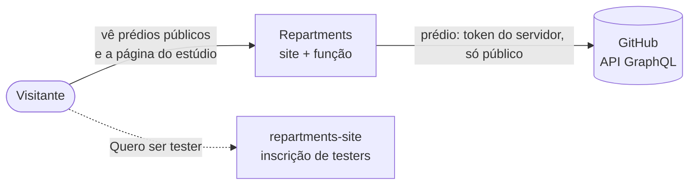
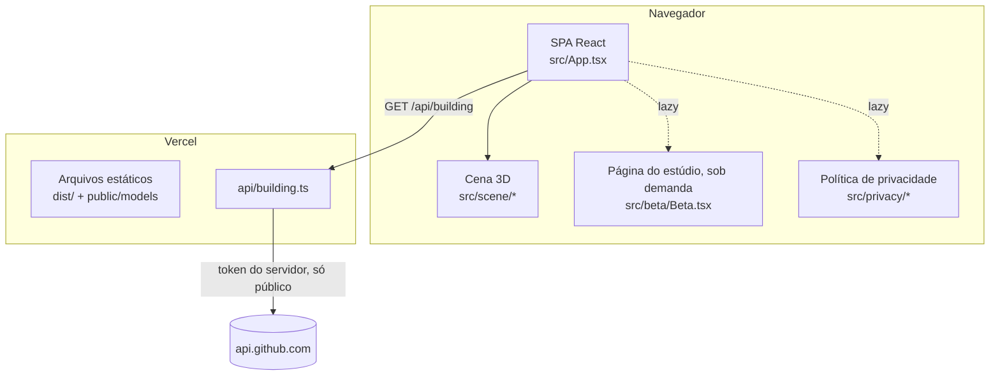
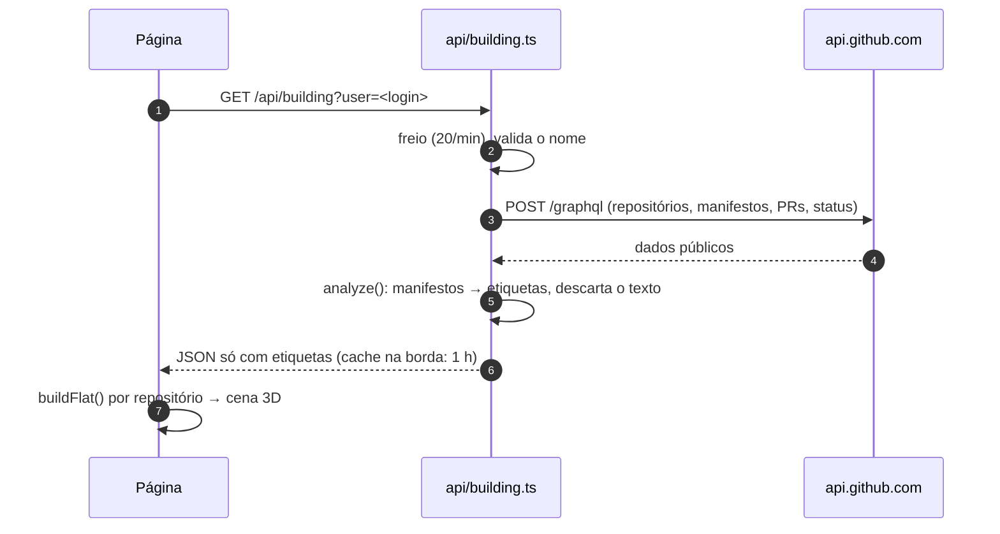
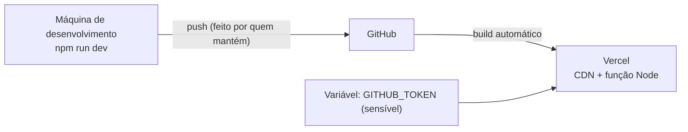

# Arquitetura do Repartments

Documento de arquitetura no formato [arc42](https://arc42.org) (resumido), com diagramas [C4](https://c4model.com) em Mermaid. O guia em linguagem do dia a dia é o [COMO-FUNCIONA.md](COMO-FUNCIONA.md); as decisões ficam nos [ADRs](adr/README.md); as rotas, na [referência da API](api.md); a configuração, em [configuracao.md](configuracao.md).

## 1. Objetivos

O Repartments mostra um repositório de código como um prédio de apartamentos em 3D, onde as partes do sistema são moradores que encenam como trabalham juntos. Este repositório tem duas coisas:

| Parte | Para quem | O que entrega |
|---|---|---|
| **Prédio público** (`/<usuário>`, `/demo`) | Qualquer visitante | Os repositórios públicos de alguém, um andar por repositório, cada tecnologia um morador. Código aberto. |
| **Página do estúdio** (`/studio`) | Quem procurava o estúdio | O estúdio está fechado para testes: a página conta de onde o projeto veio, o que vem aí, como entrar no beta, e responde as dúvidas. |

Metas de qualidade, em ordem:

1. **Privacidade e segurança:** o prédio só lê dados públicos, com um token do servidor sem permissões; nenhum código de ninguém é mostrado nem guardado; nada de login, cookie ou dado pessoal.
2. **Clareza para quem não é técnico:** frases simples em português e inglês, a animação conta o fluxo sem mostrar código.
3. **Encantar:** a cena 3D, o clima, a vida na rua, a página do estúdio animada.
4. **Previsibilidade:** a mesma análise para os mesmos manifestos (regras, sem LLM); regras testadas.
5. **Leveza de operação:** sem banco; uma função além dos arquivos estáticos.

## 2. História

O Repartments começou como um projeto de código aberto: o Prédio, que continua aqui. Depois veio o **estúdio**, onde a pessoa entrava com o GitHub, abria qualquer repositório (privado também) e o transformava numa apresentação animada para um cliente. Com o uso, apareceu a oportunidade de transformar o estúdio numa ferramenta de verdade, que roda no computador da pessoa. Por isso ele fechou para testes e o código dele saiu deste repositório, com o histórico ([ADR 0015](adr/0015-estudio-fechado.md)). A ferramenta nova é feita à parte e, por enquanto, com o código fechado.

As inscrições de testers não passam por aqui: ficam no site de divulgação (`repartments-site`), que tem o formulário, o banco e o painel de quem decide.

## 3. Restrições

- Hospedagem na **Vercel**: site estático (Vite) + uma função Node (`api/building.ts`), sem estado entre chamadas.
- Front-end em **React 19 + TypeScript + Tailwind v4**, cena 3D em **three.js / react-three-fiber**, animações da página do estúdio com **GSAP** e rolagem suave com **Lenis**.
- Dados só da **API do GitHub** (GraphQL), pelo servidor.
- CSP restrita: scripts só do próprio site, **Trusted Types** obrigatório, o navegador só fala com o próprio site e com `api.github.com`.
- Nada relacionado a ferramentas de IA de desenvolvimento entra no repositório (pastas de plugins no `.gitignore`).

## 4. Contexto (C4, nível 1)

## 5. Estratégia da solução

- **Uma consulta GraphQL por dono**, feita pelo servidor com um token sem permissões; a resposta só leva etiquetas e dados públicos.
- **Análise por regras** dos manifestos (`package.json`, `requirements.txt`, compose…), sem LLM.
- **Um motor de histórias puro** (`src/scene/story.ts`) que transforma passos em tempo, testável sem 3D.
- **Um contrato tipado** (`src/shared/types.ts`) entre a função e a página.
- **A página do estúdio é carregada sob demanda**, só para quem abre `/studio`.

## 6. Visão de blocos

### 6.1 Contêineres (C4, nível 2)

### 6.2 Servidor

| Arquivo | Responsabilidade |
|---|---|
| `api/building.ts` | A função do prédio público: freio, validação, cache. |
| `server/handler.ts` | Valida o nome, chama o GitHub, analisa, monta a resposta. |
| `server/github.ts` | A consulta GraphQL do prédio. |
| `server/analyze.ts` | Manifestos → moradores (regras). O texto dos arquivos morre aqui. |
| `server/limiter.ts` | Freio por visitante, em memória. |

### 6.3 Navegador

| Pasta / arquivo | Responsabilidade |
|---|---|
| `src/App.tsx` | Tela inicial, rotas (`/`, `/demo`, `/<usuário>`, `/studio`, `/privacidade`), painéis, troca Prédio / Estúdio. |
| `src/data/building.ts` | Rotas, busca de `/api/building` e conversão em apartamentos. |
| `src/scene/*` | O motor de histórias (`story.ts`), o gerador de apartamentos (`rooms.ts`), o caminho que desvia de móveis (`nav.ts`, [ADR 0006](adr/0006-escritorio-e-desvio-de-moveis.md)), o prédio, os apartamentos, o clima e a rua. |
| `src/beta/Beta.tsx` | A página do estúdio fechado: história, o que vem aí, como funciona o beta, perguntas e o botão de tester (`TESTER_URL`). |
| `src/privacy/*` | A política de privacidade do app ([ADR 0011](adr/0011-privacidade-e-lgpd.md)). |
| `src/security.ts` | Política de Trusted Types: só scripts do próprio site, nunca texto virando HTML. |
| `src/ui/*` | Textos em PT/EN, peças comuns e a cidade borrada do fundo. |

## 7. Visão de execução

## 8. Implantação

Passo a passo em [configuracao.md](configuracao.md). `vercel.json` define as rotas da SPA e os cabeçalhos de segurança. O build termina com `scripts/check-dist.mjs`, que interrompe o deploy se algum arquivo publicado tiver cara de segredo.

## 9. Conceitos transversais

- **Segurança.** O único segredo é o `GITHUB_TOKEN`, só no servidor, sem permissões de repositório. Nomes validados antes de chamar o GitHub (sem SSRF). Todo texto renderizado pelo React (nada de `innerHTML`). CSP com `script-src 'self'`, `connect-src 'self' https://api.github.com` e Trusted Types obrigatório. Logs sem segredo, token ou pedido (teste em `server/logs.test.ts`).
- **Privacidade.** Sem login, cookie ou dado pessoal; nenhum serviço de IA; o texto dos manifestos não sai da função. Política em `/privacidade` e `/privacy`; registro em [privacidade.md](privacidade.md).
- **Erros.** Um conjunto pequeno de códigos (`BuildingError`), traduzidos na interface.
- **Idiomas.** Todo texto visível em `pt` e `en`.
- **Acessibilidade.** Botões reais, foco visível, legendas com `aria-live`, movimento reduzido respeitado (a página do estúdio desliga as animações e a rolagem suave).
- **Desempenho.** A página do estúdio e a política carregam sob demanda; os modelos 3D são pré-carregados ao abrir um prédio.

## 10. Decisões

Ver [adr/README.md](adr/README.md).

## 11. Qualidade e testes

- `npm test` (Vitest): analisador, motor de histórias, gerador de apartamentos, caminhos, rotas, política de privacidade, logs sem segredo.
- `npm run build` checa os tipos (`tsc --noEmit`) antes do build e procura segredos no que vai ser publicado.
- `npm run check:site -- <endereço>` confere o site publicado de fora (scripts, arquivos sensíveis, cabeçalhos).

## 12. Riscos e dívidas técnicas

| Risco | Efeito | Mitigação atual / próximo passo |
|---|---|---|
| Cota do token do servidor | Prédios param por um tempo | Cache de 1 h na borda, freio por visitante, mensagem clara de `rate-limited`. |
| Repositórios enormes | Primeira consulta lenta (~20 s) | Lista curta de manifestos; cache depois. |
| Detecção por nomes de dependência | Morador a mais (ex.: um framework só nos testes) | Regras com prioridade; ampliar com casos reais. |
| `TESTER_URL` aponta para uma issue pública | Quem se inscreve por lá deixa nome e contato à vista | Trocar para o formulário do site (`/beta/`) assim que ele estiver no ar. |

## 13. Glossário

| Termo | Significado |
|---|---|
| Prédio | Os repositórios públicos de alguém. |
| Andar | Um repositório. |
| Morador | Uma tecnologia do repositório (React, Django, PostgreSQL…). |
| Cômodo | O lugar de um papel no apartamento (sala, portaria, escritório, arquivo…). |
| História | A sequência de passos que os moradores encenam (`story.ts`). |
| Estúdio | A ferramenta de apresentações, hoje fechada para testes e feita à parte. |
