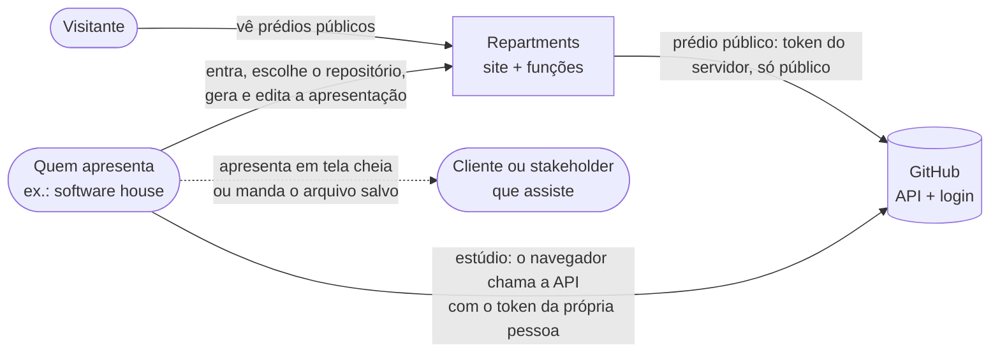
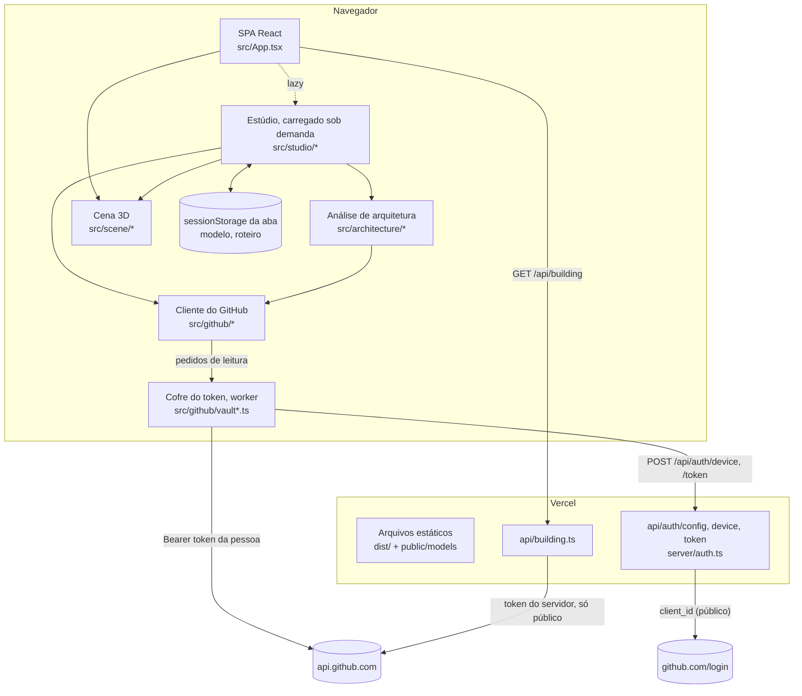
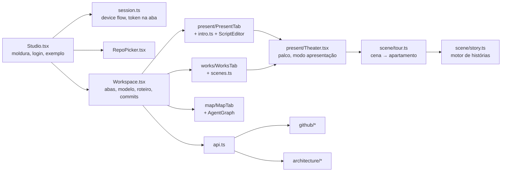
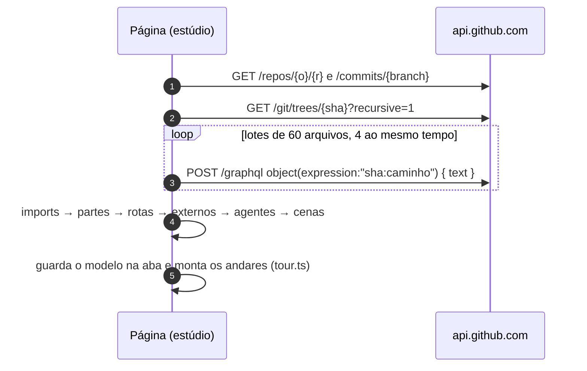
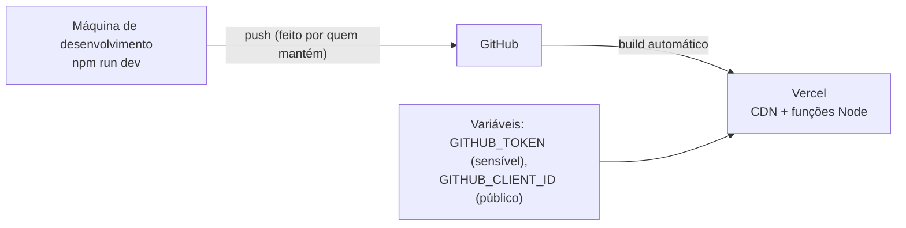

# Arquitetura do Repartments

Documento de arquitetura no formato [arc42](https://arc42.org) (resumido), com diagramas [C4](https://c4model.com) em Mermaid. O guia em linguagem do dia a dia é o [COMO-FUNCIONA.md](COMO-FUNCIONA.md); as decisões ficam nos [ADRs](adr/README.md); as rotas, na [referência da API](api.md); a leitura de repositórios, em [analise.md](analise.md).

## 1. Objetivos

O Repartments mostra um repositório de código como um prédio de apartamentos em 3D, onde as partes do sistema são moradores que encenam como trabalham juntos.

| Parte | Para quem | O que entrega |
|---|---|---|
| **Prédio público** (`/<usuário>`) | Qualquer visitante | Os repositórios públicos de alguém, um andar por repositório, cada tecnologia um morador. |
| **Estúdio** (`/studio`) | Quem entra com o GitHub (repositórios privados também), e quem assiste | **Como funciona:** o sistema encenado pelos moradores, incluindo como um agente de IA decide. **Commits:** cada commit encenado pelo autor visitando as partes que mudou. **Mapa:** a arquitetura em camadas, com o calor das mudanças. |

O estúdio nasceu do pedido de uma software house: mostrar a um cliente, de forma visual e para leigos, como o CRM dele funciona e como o agente de IA toma decisões, e o que vem mudando nele.

Metas de qualidade, em ordem:

1. **Privacidade e segurança:** nenhuma chave do estúdio no servidor; o código de clientes vai do GitHub direto para o navegador de quem tem acesso; nada fica guardado depois que a aba fecha, a não ser o que a pessoa salvar.
2. **Clareza para quem não é técnico:** frases simples em português e inglês, tamanhos em palavras, o roteiro editável com as palavras do cliente.
3. **Encantar numa apresentação:** a cena 3D, o modo tela cheia, as cenas em sequência.
4. **Previsibilidade:** a mesma análise para o mesmo commit (sem LLM); regras testadas.
5. **Leveza de operação:** sem banco; duas funções pequenas além do prédio público.

## 2. Restrições

- Hospedagem na **Vercel**: site estático (Vite) + funções Node (`api/`), sem estado entre chamadas.
- Front-end em **React 19 + TypeScript + Tailwind v4**, cena 3D em **three.js / react-three-fiber**.
- Dados só da **API do GitHub** (REST e GraphQL).
- CSP restrita: scripts só do próprio site; o navegador só fala com o próprio site e com `api.github.com`.
- Nada relacionado a ferramentas de IA de desenvolvimento entra no repositório (pastas de plugins no `.gitignore`).

## 3. Contexto (C4, nível 1)

## 4. Estratégia da solução

- **Login pelo device flow** do GitHub, com só o *Client ID* (público) no servidor ([ADR 0001](adr/0001-login-pelo-device-flow.md)).
- **Token só na aba** e **chamadas diretas** do navegador ao GitHub; o servidor só repassa o login ([ADR 0002](adr/0002-token-so-no-navegador.md)).
- **Análise estática no navegador** que produz um modelo de arquitetura com as cenas já escritas ([ADR 0003](adr/0003-analise-estatica-sem-llm.md), [analise.md](analise.md)).
- **Um palco para tudo**: o motor de histórias do prédio público toca a apresentação e os commits ([ADR 0004](adr/0004-apresentacao-no-motor-de-historias.md), [ADR 0005](adr/0005-commits-como-cenas.md)).
- **Um contrato tipado** (`src/shared/types.ts`, `src/shared/studio.ts`) entre as partes.

## 5. Visão de blocos

### 5.1 Contêineres (C4, nível 2)

### 5.2 Servidor

| Arquivo | Responsabilidade |
|---|---|
| `server/auth.ts` | Repasse sem estado do device flow: `config`, `device`, `token`; atalho do GitHub CLI só em desenvolvimento. Freios por visitante, origem própria em POST. |
| `server/limiter.ts` | Freio por visitante, em memória. |
| `server/handler.ts`, `github.ts`, `analyze.ts` | Prédio público (inalterados). |

### 5.3 Navegador (estúdio)

| Pasta / arquivo | Responsabilidade |
|---|---|
| `src/studio/Studio.tsx` | Cabeçalho, estados do login (código do device flow), lista de repositórios, exemplo embutido, abrir apresentação salva. |
| `src/studio/session.ts` | O estado do login para as telas (vindo do cofre), contagem regressiva das 8 horas. |
| `src/github/vault*.ts`, `allow.ts` | O cofre do token: um worker que faz o device flow, guarda o token na memória, só deixa passar leituras e esquece tudo em 8 horas. |
| `src/security.ts` | Política de Trusted Types: só scripts do próprio site, nunca texto virando HTML. |
| `src/studio/api.ts` | Todas as chamadas ao GitHub feitas pela página, com erros traduzidos. |
| `src/studio/Workspace.tsx` | Abas Como funciona / Commits / Mapa; guarda o modelo, o roteiro, o commit em cena e o calor; aplica os nomes do roteiro no mapa e nos commits; salvar apresentação. |
| `src/studio/present/*` | `Theater` (o palco: prédio, cenas, painel, modo tela cheia com avanço automático), `PresentTab`, a cena de abertura (`intro.ts`) e o editor de roteiro. |
| `src/studio/works/*` | Commits em cena (`scenes.ts`, puro) e a aba (`WorksTab.tsx`): 12 commits por prédio, filtros, calor. |
| `src/studio/map/*` | Mapa em faixas por camada (C4 simplificado), sobreposições de calor e do commit, grafo de decisão dos agentes. |
| `src/studio/store.ts`, `example.ts` | Memória da aba, arquivo de apresentação (validado ao abrir) e o exemplo de CRM. |
| `src/studio/export/*` | A apresentação como arquivo, feita no navegador: vídeo gravado do canvas com as legendas desenhadas (`video.ts`) e PowerPoint com uma foto por cena (`deck.ts`, carregado só quando pedido). [ADR 0007](adr/0007-video-e-powerpoint-no-navegador.md). |
| `src/github/*` | Cliente do GitHub para o navegador; repositórios; commits, branches e calor. |
| `src/architecture/*` | Análise estática ([analise.md](analise.md)). |
| `src/scene/tour.ts` | Gera um apartamento jogável a partir de uma cena (fileira para cenas pequenas, escritório com corredor para as grandes); aplica o roteiro; paredes aquecidas pelo calor. |
| `src/scene/nav.ts`, `footprints.ts` | Caminhos que desviam de móveis e paredes (A* numa grade), usados por todas as histórias ([ADR 0006](adr/0006-escritorio-e-desvio-de-moveis.md)). |

## 6. Visão de execução

### 6.1 Login

Diagrama completo em [api.md](api.md#login-do-estúdio-serverauthts). Em resumo: a página pede um código pelo repasse, mostra o código e abre `github.com/login/device`, consulta o repasse no ritmo que o GitHub pede e, aprovado, guarda o token na aba e pergunta ao GitHub quem é a pessoa.

### 6.2 Análise da arquitetura

### 6.3 Commits em cena

1. A aba **Commits** lista os commits dos filtros (`GET /commits`) e lê os arquivos dos 12 do prédio (`GET /commits/{sha}`, 4 por vez).
2. `scenes.ts` agrupa os arquivos por parte (`componentOf`), escreve a cena de cada commit e a do térreo ("Onde o trabalho acontece") e calcula o calor de cada cômodo.
3. O commit em cena e a soma dos commits vão para o `Workspace`: o **Mapa** destaca as partes daquele commit ou pinta todas pelo calor.

## 7. Implantação

Passo a passo em [configuracao.md](configuracao.md). `vercel.json` define rotas da SPA e cabeçalhos de segurança.

## 8. Conceitos transversais

- **Segurança.** Nenhum segredo do estúdio no servidor. O token fica trancado no cofre (um worker): nem a página o vê, ele só faz leituras de uma lista fechada e some em 8 horas (com contagem no cabeçalho e aviso nos últimos 10 minutos). CSP: `script-src 'self'`, `connect-src 'self' https://api.github.com`, Trusted Types obrigatório. Todo texto renderizado pelo React (nada de `innerHTML`). Arquivos de apresentação abertos são validados e reconstruídos campo a campo. O repasse do login valida o código, exige origem própria e tem freio. Nomes de dono e repositório validados antes de chamar o GitHub.
- **Privacidade.** O código vai do GitHub direto para a aba; nenhum serviço de IA; nunca lê `.env`, chaves e certificados. Modelo e roteiro somem com a aba; o arquivo salvo leva roteiro, nomes de partes e arquivos e o começo das instruções dos agentes, nunca código.
- **Erros.** Um conjunto pequeno de códigos (`StudioErrorCode`), traduzidos na interface; 401 encerra o login.
- **Idiomas.** Todo texto visível em `pt` e `en`; o modelo traz as frases nas duas línguas.
- **Acessibilidade.** Botões reais, abas com `role="tab"`, passos com `aria-current`, legendas com `aria-live`; foco visível; movimento reduzido respeitado.
- **Desempenho.** O estúdio é carregado sob demanda (fica fora do pacote do prédio público); os modelos 3D da apresentação são pré-carregados.

## 9. Decisões

Ver [adr/README.md](adr/README.md).

## 10. Qualidade e testes

- `npm test` (Vitest): analisador público, motor de histórias, geradores de apartamento, de apresentação e de cenas de commits, cena de abertura, repasse do login, cliente do GitHub (repositórios, commits), análise de arquitetura (com um CRM de exemplo), mapa e grafo dos agentes, utilitários.
- `npm run build` checa os tipos (`tsc --noEmit`) antes do build.
- Visual conferido no navegador em desktop e celular: login, exemplo, apresentação, commits e mapa.

## 11. Riscos e dívidas técnicas

| Risco | Efeito | Mitigação atual / próximo passo |
|---|---|---|
| Script injetado na página | Poderia pedir leituras ao cofre enquanto o login dura | Token fora do alcance da página, só leituras permitidas, 8 h no máximo, CSP com Trusted Types, React escapando texto. |
| Heurísticas erram nomes e fluxos | Cena estranha para o cliente | Roteiro editável (renomeia em todas as abas); nota "gerado a partir do código". |
| Agente de IA não reconhecido | Falta a cena mais pedida | Aviso na apresentação com os SDKs reconhecidos; ampliar as regras com casos reais. |
| Repositório muito grande | Análise parcial (`truncated`) | Orçamento de 700 arquivos / 7 MB; o mapa avisa. Próximo: escolher pastas. |
| Cota do GitHub da pessoa | Análise e commits param por um tempo | 12 commits por prédio, 4 chamadas por vez; mensagem clara de `rate-limited`. |
| Arquivo salvo circula | Nomes internos e instruções do agente de um cliente | Aviso no botão; revisar o roteiro antes de enviar. |

## 12. Glossário

| Termo | Significado |
|---|---|
| Prédio | Repositórios de alguém (público), as cenas de um repositório ou os commits recentes (estúdio). |
| Andar | Um repositório (público), uma cena ou um commit (estúdio). |
| Morador | Uma tecnologia (público) ou uma parte do sistema, ferramenta, serviço, autor (estúdio). |
| Parte / componente | Uma pasta do repositório (ou os arquivos soltos nela) com um papel. |
| Camada | Telas, API, segurança, regras, IA, tarefas, dados, compartilhado, infraestrutura, testes. |
| Cena (`Flow`) | Uma sequência de passos entre participantes. |
| Calor | Quanto cada parte mudou nos commits em cena. |
| Roteiro | Os textos da apresentação, editáveis por quem apresenta. |
